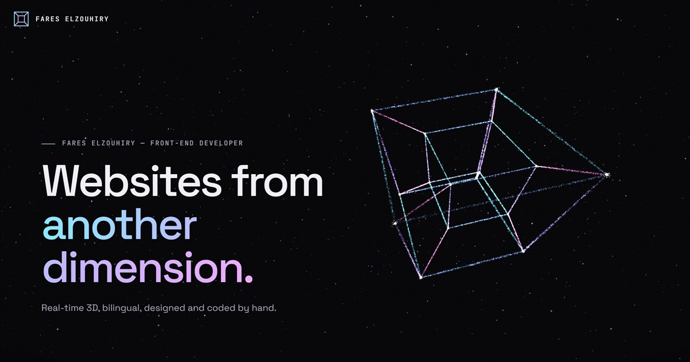

# Fares Elzouhiry — Portfolio

**Websites from another dimension.** A one-page portfolio built around a live particle engine written from scratch in WebGL2: about 41,000 points of light (about 25,000 on phones) that start as a tesseract (a cube rotating through the fourth dimension), become an emblem for each project and then assemble into that project's real pages, and end as a ringed planet. The page is six screens.

- **Live site:** https://fareselzouhiry.github.io/Fares-Elzouhiry/
- **Repository:** https://github.com/FaresElzouhiry/Fares-Elzouhiry
- **Languages:** English (default) and Arabic, switched with the button in the top bar. A link can open the Arabic version directly: `…/Fares-Elzouhiry/?lang=ar`.



---

## The six screens

Every section is exactly one screen. A flick on a phone, one notch of a mouse wheel, one trackpad swipe or one arrow key moves exactly one section, and the scene changes on its own as each section arrives.

| # | Section | Link | What the particles become |
|---|---|---|---|
| 0 | Intro | `#top` | A **4D tesseract**: the 32 edges of a four-dimensional cube, rotated in four dimensions and projected into 3D |
| 1 | Alliance Investment | `#alliance` | A **globe** of the world's land in light, Saudi Arabia in gold, and a line from Riyadh to each of the 15 other network countries with a pulse running out along it → then **the Alliance home page**, with the **six designs made for the CEO** under it (Gateway was chosen and became the website) |
| 2 | Doctor Dashboard | `#doctor` | A **QR code** inside a scanner's viewfinder, with a scan line passing over it → then **the dashboard and a student's phone** saying "Checked in", with the dashboard's pages under it |
| 3 | University App | `#uni` | A **focus timer**: a ring with a light running round it, minute ticks, and "25:00" written in particles → then **three screens of the app**, with its pages under it |
| 4 | TSUB Global Services | `#tsub` | **Three ribbons**, white, green and red, rising from one point around a dotted globe (the company's logo idea) → then **the TSUB home page** on a laptop and a phone, with its pages under it |
| 5 | Contact | `#contact` | A **ringed planet** — "Let's build something out of this world." |

Each project's emblem holds for about two seconds (and for as long as you're turning it), then its particles assemble into the project's real screens: first as a mosaic (each particle takes the colour of its pixel), then the sharp picture sweeps in behind a bright scan line. The screens stay for about five seconds, then the particles fly back into the emblem, and the loop carries on while you stay on the section. Clicking or tapping the emblem or the picture, **All screens**, or any thumbnail in the strip opens a gallery of that project's pictures with captions.

- **Grab the shape:** with a mouse, drag anywhere in the empty space. On a phone, swipe sideways (up and down still scrolls). Project screens tilt in 3D and ease back.
- **On phones**, the emblem and then the picture fill the top of the screen (the picture is a portrait mockup: phones and a laptop window), with the name, one line, the buttons and the page strip underneath.
- **The dots** on the right (at the bottom on phones) jump to any section.

### The projects

| Project | Links |
|---|---|
| **Alliance Investment** — a six-language website for an investment holding in Riyadh, opening on a live 3D globe of its 16-country network | [Live](https://fareselzouhiry.github.io/Alliance/) · [Code](https://github.com/FaresElzouhiry/Alliance) |
| **Doctor Dashboard** (Juster) — students scan the doctor's QR code and appear live, only from inside the hall | [Code](https://github.com/FaresElzouhiry/Uni-app) |
| **University App** (Juster) — the student app: live schedule, tasks, focus rooms; installable and offline | [Code](https://github.com/FaresElzouhiry/Uni-app) |
| **TSUB Global Services** — a cinematic site linking Saudi Arabia and Bangladesh around a 3D globe and the logo's ribbons | [Live](https://fareselzouhiry.github.io/TSUB/) · [Code](https://github.com/FaresElzouhiry/TSUB) |

The dashboard screenshots use **sample data**: they were taken locally with the attendance API answered by a small script, so nothing reached the real server, and the QR code in them points to this portfolio.

---

## How it works

Everything is in `index.html` (HTML, CSS and JavaScript) plus the pictures in `img/`. No 3D library: the engine is plain WebGL2.

| Part | How it is done |
|---|---|
| Particles | 40,960 on computers, 24,576 on phones. Every shape is stored on the graphics card as a texture of positions and a texture of colours; one draw call renders them all |
| Morphing | The vertex shader reads the particle's place in two shapes and blends between them; each particle starts at a slightly different moment, and a swirl is added mid-flight |
| Sections | CSS scroll snapping (`scroll-snap-type: y mandatory` with `scroll-snap-stop: always`), so a flick never skips a project. Browsers snap a short wheel scroll back to where it started, so the page reads the wheel and the keyboard itself and moves one section per notch or key; a trackpad's coasting is ignored until a pause or a fresh swipe |
| Transitions | Time-based, not tied to the scroll: when a section arrives, the particles fly to its emblem in about 1.25 seconds, hold it, then fly into the project's screens, and back again in a loop. If you move on before they land, they finish quickly and carry on to where you are |
| The fourth dimension | The tesseract's points have four coordinates; the shader rotates them in the XW, YW and ZW planes and projects them into 3D with a perspective divide on W. Dragging turns it through the fourth dimension |
| Dragging | Pointer events with inertia. The sections allow only vertical panning (`touch-action: pan-y pinch-zoom`), so on a touch screen a swipe that starts sideways belongs to the shape, while up and down still scroll and pinch still zooms |
| Effects | Light pulses run out along the Alliance lines, a scan line crosses the QR code, and a light runs round the timer ring — all computed per particle in the shader |
| Screens | Each project picture is sampled into a grid of particles for the mosaic, then drawn sharp on a quad whose shader reveals it top-down with a scan line and a slight colour split. Phones load the portrait pictures (`img/stage/m-*.jpg`), computers the wide ones |
| Layout | The shapes are sized and placed in the free space beside the text (above it on phones), and mirrored for Arabic. On short phones the one-line description is dropped so the picture keeps its room |
| Extras | A starfield, film grain, a vignette, a cursor ring that grows over anything clickable (and says "OPEN" over a project's emblem or picture), and titles that decode from noise when their section arrives |
| Speed | About 90 KB of page and 500 KB of pictures on first load; 60 frames a second in testing. If a device can't keep up, the page renders at a lower resolution instead of stuttering |
| Fallback | Without WebGL2, or when `index.html` is opened straight from disk, it becomes a plain scrolling page with the same words, page strips and pictures; the gallery still works |
| Reduced motion | With the system's reduced-motion setting on, the swirl, spins and decoding stop, and each project shows its screens without the fly-in or the loop |

## Files

```
index.html     the whole site
img/           full-size screenshots (gallery) and og.jpg (link preview)
img/stage/     the pictures the particles assemble into: <name>.jpg for computers (1600×1000),
               m-<name>.jpg for phones (1000×1250)
img/xs/        thumbnails
serve.ps1      small local server for previewing
README.md      short guide in Arabic
PORTFOLIO.md   this file
```

## Running it locally

The 3D needs the page to be served over HTTP (browsers block reading images into WebGL on pages opened from disk):

```
powershell -ExecutionPolicy Bypass -File serve.ps1
```

Then open http://localhost:8765

## Editing

| To change | Look for |
|---|---|
| Text | Each sentence is written twice: `class="en"` for English and `class="ar"` for Arabic |
| A project | Its `<section class="sec proj" id="…">` |
| The pages shown under a project | The `<div class="strip">` inside its section |
| What the particles become | `ST` in the script (0 the tesseract, 1–4 the projects' emblems, 5 the planet, 6–9 the projects' screens) and the `sh…` functions that build each shape |
| How long the emblem and the screens hold in each project's loop | `HOLD` in the script (2200 ms for the emblem, 5000 ms for the screens) |
| How fast a section changes | The `goTo` call in `frame` (1.25 s) |
| A project's picture | `img/stage/<name>.jpg` (1600×1000) and `img/stage/m-<name>.jpg` (1000×1250, for phones) |
| Gallery pictures and captions | `GAL` in the script; each picture needs a copy in `img/` and in `img/xs/` |
| Email | Search for `fa872328@gmail.com` |

## Publishing

GitHub Pages from the `main` branch. Push `index.html` and the whole `img/` folder and the live site updates within a minute or two.
