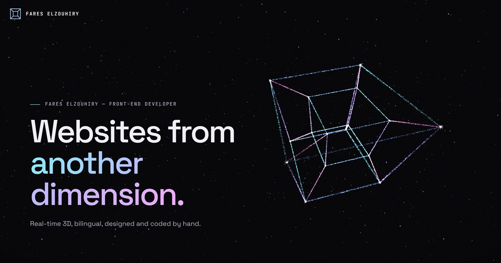

# Fares Elzouhiry — Portfolio

**Websites from another dimension.** A one-page portfolio that is a flight through a tunnel, built on a 3D engine written from scratch in WebGL2. Scrolling flies a camera forward through rings of light; every project's real screen floats in space, swings to the front and turns toward you as you arrive, then the camera flies past it to the next. A 4D tesseract waits at the entrance and a ringed planet at the end. The page opens with a short intro animation and has ten stops: an intro, eight projects grouped by kind (websites, apps, a presentation, 3D modeling and a game) and a contact screen.

- **Live site:** https://fareselzouhiry.github.io/Fares-Elzouhiry/
- **Repository:** https://github.com/FaresElzouhiry/Fares-Elzouhiry
- **Languages:** English (default) and Arabic, switched with the button in the top bar. A link can open the Arabic version directly: `…/Fares-Elzouhiry/?lang=ar`.



---

## The ten stops

Every section is exactly one screen and one stop along the tunnel. A flick on a phone, one notch of a mouse wheel, one trackpad swipe or one arrow key moves exactly one stop, and the camera flies there.

| # | Stop | Link | What floats in front |
|---|---|---|---|
| 0 | Intro | `#top` | A **4D tesseract**: the 32 edges of a four-dimensional cube, rotated in four dimensions and projected into 3D |
| 1 | Websites · Alliance Investment | `#alliance` | **The Alliance home page**, with the **six designs made for the CEO** in the gallery (Gateway was chosen and became the website) |
| 2 | Websites · BBQ Fest | `#bbqfest` | **The light "butcher paper" design** (the one the client chose), with the three designs and the 3D map in the gallery |
| 3 | Apps · Doctor Dashboard | `#doctor` | **The dashboard and a student's phone** saying "Checked in" |
| 4 | Apps · University App | `#uni` | **Three screens of the app** |
| 5 | Presentations · Sport Barbecue | `#bbqpres` | **The cover of model 3, the 3D night stadium** |
| 6 | 3D Modeling · MHC Coalline | `#mhc` | **The six 3D scenes** made for the coal maker (ember, factory line, globe, bag, mountain, shards) |
| 7 | 3D Modeling · BBQ Fest in 3D | `#fest3d` | **The festival modeled in 3D**, from above |
| 8 | Games · Pizza Spin | `#pizza` | **The game's split screen** |
| 9 | Contact | `#contact` | A **ringed planet** — "Let's build something out of this world." |

While you are at a stop, the next projects can already be seen hanging further down the tunnel. When you arrive, the screen swings to the front, a line of light scans down it, and it tilts gently toward the mouse. Clicking or tapping it, **All screens**, or any thumbnail opens a gallery of that project's pictures with captions.

- **The words:** on a computer they sit low on the screen — a giant outlined number, the kind of work, the name and one line on the left; the buttons on the right. On phones the 3D fills the top half and the words are kept short underneath (the page strip, the tags and the drag hint are left to computers, and long descriptions are cut to three lines). In Arabic everything is mirrored.
- **Depth list:** down the right side, every stop with its number, grouped under the five kinds of work; the one you are at lights up in its colour. One click flies there.
- **Category bar:** along the bottom, a bar fills up as you fly, with the five kinds as stops on it (Websites, Apps, Presentations, 3D, Games); the one you are in lights up, and clicking one flies to its first project. On phones the kinds show as icons.
- **The tunnel's colours:** the rings take the colour of the kind of work you are passing through, and a bright triple ring marks the gate into each kind. Flying faster makes the tunnel glow brighter.
- **Chapter cards:** the five kinds of work are chapters. Flying into a new one (from the intro into Websites, from Websites into Apps, and so on) fills the screen for a moment with its name, icon, chapter number ("Chapter 02 / 05") and how many projects it holds, in its colour; the project's words wait until it fades.
- **Every kind has its own colour and atmosphere:** Websites cyan, Apps violet, Presentations pink, 3D Modeling teal, Games yellow. The glow behind the tunnel slowly shifts to the colour of the kind you are in, the rings take it on, and every project wears it: its category tag (bigger, with the icon), its giant number and a thin bar beside its words.
- **Visit site:** every project has a **Visit site** button as its main action, in the project's colour with a live dot. It opens the real project in a new tab.
- **Drag:** with a mouse, drag anywhere in the empty space to turn the tesseract or tilt a screen. On a phone, swipe sideways (up and down still scroll).
- **Opening:** every visit starts with a short opening (about two and a half seconds): the logo draws itself, the name settles, and the five kinds of work light up. Then the camera flies into the tunnel. A click, tap, scroll or key skips it.
- **Kinds of work:** the projects are grouped and ordered by kind. The first screen shows five cards (Websites, Apps, Presentations, 3D Modeling, Games) with their projects inside; one tap jumps to any project. Every project carries its kind as a tag ("Websites 1/2").
- **Pizza Spin plays in the browser:** "Play" opens `play/`, which runs the game with the keyboard for one person (W/S walk, A/D turn, Space to use, F shove, E item, Esc pause; the mouse or A/D for the dough). The second chef is the computer: it joins by itself and stays out of the way. The game file itself is unchanged: `play/keys.js` hands it a virtual controller. With two real controllers, "Two players?" in the game opens the original two-player version.
- **Language:** visitors whose browser is set to Arabic get the Arabic version straight away; everyone else gets English, and the button in the top bar switches.

### The projects

| Project | Links |
|---|---|
| **Alliance Investment** *(website)* — a six-language website for an investment holding in Riyadh, opening on a live 3D globe of its 16-country network | [Live](https://alliance.sa) |
| **BBQ Fest** *(website)* — the website for a five-day BBQ festival in Riyadh in the light "butcher paper" design the client chose, with a 3D map of the whole festival | [Live](https://fareselzouhiry.github.io/bbq-fest/model-2.html) · [All three designs](https://fareselzouhiry.github.io/bbq-fest/) · [Code](https://github.com/FaresElzouhiry/bbq-fest) |
| **Doctor Dashboard** (Juster) *(app)* — students scan the doctor's QR code and appear live, only from inside the hall | [Live](https://fareselzouhiry.github.io/Uni-app/Doctor.html) (asks for the teacher key) · [Code](https://github.com/FaresElzouhiry/Uni-app) |
| **University App** (Juster) *(app)* — the student app: live schedule, tasks, focus rooms; installable and offline | [Live](https://fareselzouhiry.github.io/Uni-app/) · [Code](https://github.com/FaresElzouhiry/Uni-app) |
| **Sport Barbecue** *(presentation)* — a 27-slide sponsor deck for Riyadh 2027 set in a 3D night stadium (model 3), in Arabic and English | [Live](https://fareselzouhiry.github.io/web/models/3/) · [Code](https://github.com/FaresElzouhiry/web) |
| **MHC Coalline** *(3D modeling)* — six 3D worlds for a charcoal maker, modeled in code and running live in the browser | [Live](https://fareselzouhiry.github.io/MHC-Coalline/) · [Code](https://github.com/FaresElzouhiry/MHC-Coalline) |
| **BBQ Fest in 3D** *(3D modeling)* — the whole festival modeled in 3D (133 booths, stage, food trucks, palms, balloon), by day, sunset or night, and you can walk inside it | [Live](https://fareselzouhiry.github.io/bbq-fest/map-3d.html) |
| **Pizza Spin** *(game)* — a first-person cooking duel; one player with the keyboard, or two players with controllers; one HTML file, no libraries | [Play](https://fareselzouhiry.github.io/Fares-Elzouhiry/play/) |

The dashboard screenshots use **sample data**: they were taken locally with the attendance API answered by a small script, so nothing reached the real server, and the QR code in them points to this portfolio.

---

## How it works

Everything is in `index.html` (HTML, CSS and JavaScript) plus the pictures in `img/`. No 3D library: the engine is plain WebGL2.

| Part | How it is done |
|---|---|
| The tunnel | About 29,000 points on computers (fewer on phones): rings every 1.75 units along the tunnel, coloured by the kind of work they lead to, a triple ring at the gate of each kind, and dust drifting all along it. One draw call; points fade in the distance and right in front of the camera |
| The camera | Each stop is 13 units further down the tunnel. The camera's position follows the scroll smoothly (it eases toward where the page is), and sways a little with the mouse |
| The screens | Each project's picture is a textured quad with rounded corners, a thin glowing edge in the project's colour and a scan of light when it arrives. It waits off to the side of the tunnel, swings to the front as the camera approaches, and gets out of the way quickly once the camera starts to pass it. Drawn farthest first, with fog |
| The fourth dimension | The tesseract's points have four coordinates; the shader rotates them in the XW, YW and ZW planes and projects them into 3D with a perspective divide on W. Dragging turns it through the fourth dimension |
| Sections | CSS scroll snapping (`scroll-snap-type: y mandatory` with `scroll-snap-stop: always`), so a flick never skips a project. The page reads the wheel and the keyboard itself and moves one stop per notch or key; a trackpad's coasting is ignored until a pause or a fresh swipe |
| Layout | On computers the screen floats to the right of the words (left in Arabic); on phones the engine measures the space between the top bar and the words of the stop on screen and fits the 3D into it |
| Extras | Film grain, a vignette, a cursor ring that grows over anything clickable (and says "OPEN" over the screen in front), and titles that decode from noise when their section arrives |
| Speed | Nothing waits for the project pictures: each screen fills in as its picture arrives, the nearest first. Nothing on the page blurs what is behind it (re-blurring a moving 3D scene every frame was the most expensive thing on the page), the chapter card animates only position and opacity, points too faint to see are skipped, and the cursor checks what is under it only when it moves. In testing: 165 frames a second (the screen's refresh rate) on a computer and a phone-sized screen, no frame slower than 12 ms when flying between stops, and above 100 frames a second on a phone slowed down four times. The 3D draws at the screen's full sharpness (up to 2× on computers, 2.25× on phones) and the pictures are sampled slightly sharp. Only if a device is slow for two seconds in a row (not counting loading) does it lower its resolution, and it goes back up as soon as there is room again |
| Fallback | Without WebGL2, or when `index.html` is opened straight from disk, it becomes a plain scrolling page with the same words, page strips and pictures; the gallery still works |
| Reduced motion | With the system's reduced-motion setting on, the camera jumps between stops instead of flying, and the sway, spin and decoding stop |

## Files

```
index.html     the whole site
img/           full-size screenshots (gallery) and og.jpg (link preview)
img/stage/     the pictures that float in the tunnel: <name>.jpg for computers (2000×1250),
               m-<name>.jpg for phones (1200×1500)
img/xs/        thumbnails
play/          index.html (keyboard, one player) + keys.js, and pizza-spin.html (the original game, untouched)
serve.ps1      small local server for previewing
README.md      short guide in Arabic
PORTFOLIO.md   this file
```

## Running it locally

The 3D needs the page to be served over HTTP (browsers block reading images into WebGL on pages opened from disk):

```
powershell -ExecutionPolicy Bypass -File serve.ps1
```

Then open http://localhost:8765

## Editing

| To change | Look for |
|---|---|
| Text | Each sentence is written twice: `class="en"` for English and `class="ar"` for Arabic |
| A project | Its `<section class="sec proj" id="…">`, its entry in `PROJ` and `KIND` in the script, a button in the depth list (`<nav class="depth">`) and its picture in `img/stage/` |
| Where Visit site goes | In each project's section, the `<a class="pri">` button; also `link` for that project in `GAL` (the gallery's button) |
| The pages shown under a project | The `<div class="strip">` inside its section (shown on phones and in the plain page) |
| The tunnel | `S` (distance between stops), `DIST` (how far ahead each screen floats) and `FAR` (how far you can see) at the top of the engine; the rings and dust are built right after the shaders |
| Where a screen waits and where it comes to | `place()` in the engine |
| A project's picture | `img/stage/<name>.jpg` (2000×1250) and `img/stage/m-<name>.jpg` (1200×1500, for phones). Captured at double density so they stay sharp on retina screens; gallery pictures are 2400 wide |
| Gallery pictures and captions | `GAL` in the script; each picture needs a copy in `img/` and in `img/xs/` |
| Email | Search for `fa872328@gmail.com` |

## Publishing

GitHub Pages from the `main` branch. Push `index.html`, the `play/` folder and the whole `img/` folder and the live site updates within a minute or two.
